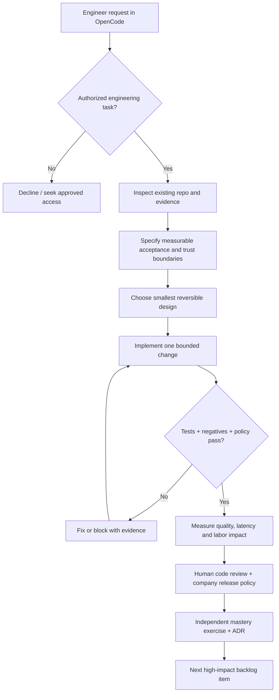
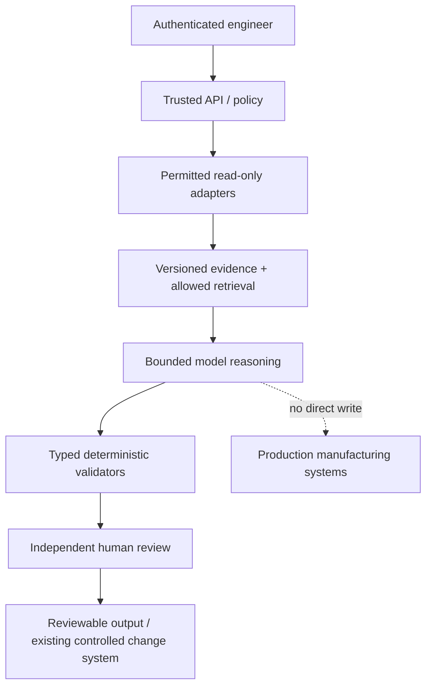

# Golden blueprint — fast mental model

For each independent application the production runtime follows a separate trust path:

The dashed line documents a *forbidden* link, not a permission. This starter cannot connect to the real endpoints shown. No enterprise service is implied by the diagrams.
